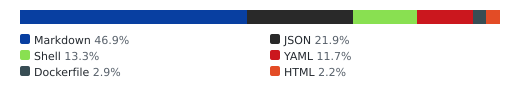
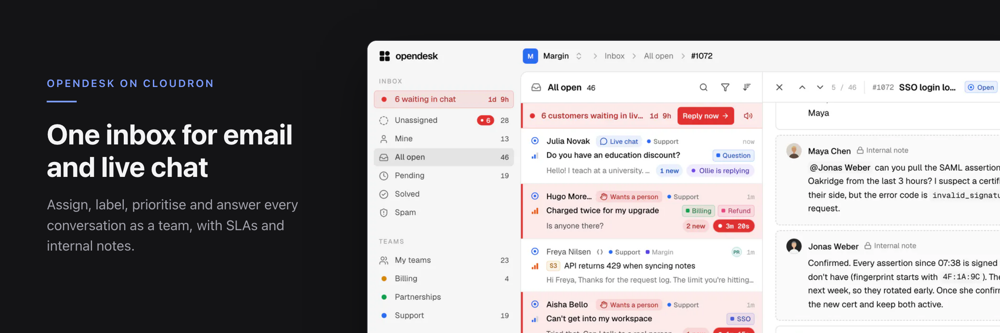
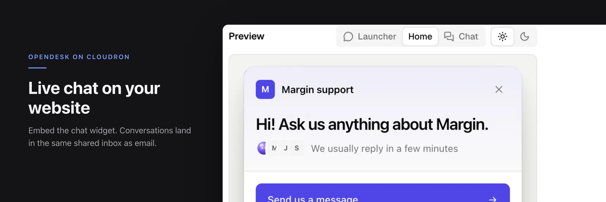
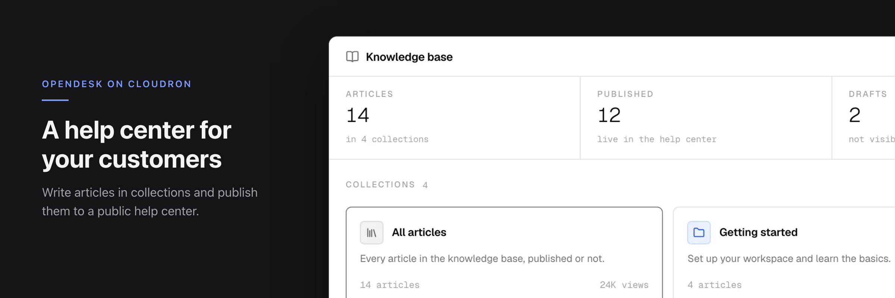
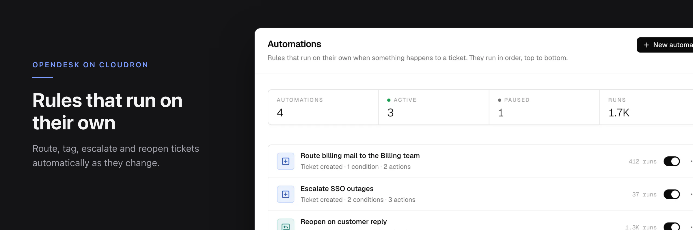
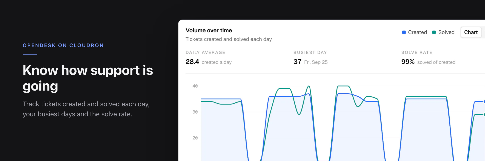
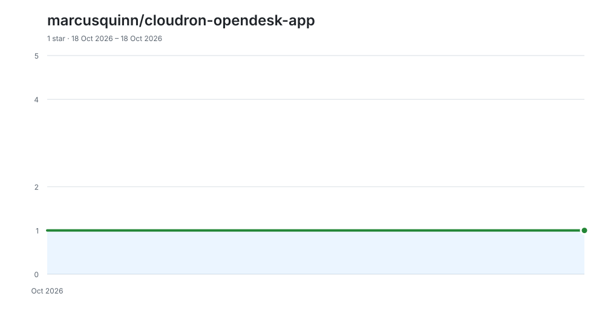

# opendesk for Cloudron

<!-- aidevops:badges:start -->
<!-- managed by aidevops badges; edit the template, not this block -->
[](https://github.com/marcusquinn/cloudron-opendesk-app/blob/main/LICENSE)
[](https://github.com/marcusquinn/cloudron-opendesk-app/releases/latest)

[](docs/metrics/repo-metrics.md)
[](docs/metrics/repo-metrics.md)

[](docs/metrics/repo-metrics.md)
<!-- aidevops:badges:end -->

Cloudron package for [opendesk](https://github.com/useopendesk/opendesk), the
open-source helpdesk: a shared inbox for email and live chat, an embeddable
chat widget, a public help center, automations, SLAs and reports.



| | |
|---|---|
|  |  |
|  |  |

Screenshots: opendesk's own product images (Apache-2.0), framed for the
Cloudron store. See [DESIGN.md](DESIGN.md).

## What the package adds

- **Cloudron single sign-on.** Users sign in with their Cloudron account
  (`oidc` addon). The first sign-in creates the opendesk account; password
  registration stays closed.
- **Outgoing mail through Cloudron.** Sign-in links, invitations and
  notifications go through the Cloudron mail relay (`sendmail` addon).
- **Support mailboxes on Cloudron Mail.** Add a mailbox hosted on this
  Cloudron with its address and password; the IMAP and SMTP settings fill in,
  and the connection uses the internal network with TLS still verified.
- **Everything on Cloudron's services.** PostgreSQL addon (with `citext` and
  `vector`), attachments under `/app/data/files`, all included in Cloudron
  backups.
- **Built from source.** A pinned upstream commit (`OPENDESK_COMMIT` in the
  `Dockerfile`) plus the small patches in [`patches/`](patches/), all build
  images pinned by digest.

## Install

**From the catalog.** In the Cloudron dashboard, open
*Settings → Community apps*, add the catalog URL below and install opendesk
from the App Store, or use the CLI:

```sh
cloudron install --versions-url https://raw.githubusercontent.com/marcusquinn/cloudron-opendesk-app/main/CloudronVersions.json --location support.example.com
```

**From source.** Cloudron builds the image on your server (Go, Node and Elixir
stages; allow 10–20 minutes on a small server):

```sh
git clone https://github.com/marcusquinn/cloudron-opendesk-app.git
cd cloudron-opendesk-app
cloudron install --location support.example.com
```

`cloudron update --app support.example.com` rebuilds from a newer checkout.

To move a source-built install onto the catalog, keeping its data, address and
mailboxes, run this (Cloudron CLI 9.0 or later; the update takes a backup
first). New catalog versions then show up as updates, which Cloudron installs
automatically or leaves for you to apply, depending on the app's update setting.

```sh
cloudron update --app support.example.com --force \
  --versions-url https://raw.githubusercontent.com/marcusquinn/cloudron-opendesk-app/main/CloudronVersions.json
```

Requirements: Cloudron 9.1 or later, 1 GiB of memory for the app (raise it in
the app's *Resources* for large teams or heavy AI use).

## Set up

1. **Sign in.** Open the app and choose *Continue with* your Cloudron. The
   first user creates the workspace and invites the rest of the team. Who can
   sign in is set by the app's *Access control* in Cloudron.
2. **Become instance admin** (optional; opens the admin panel at `/admin/`).
   In the app's *Terminal*, or from your machine:

   ```sh
   cloudron exec --app support.example.com -- opendesk-cli admin grant you@example.com
   cloudron exec --app support.example.com -- opendesk-cli admin list
   ```

3. **Connect a support mailbox.**
   1. In Cloudron, *Email → your domain*: create the mailbox, e.g.
      `support@example.com`, and any aliases such as `help@example.com`.
   2. In opendesk, *Settings → Mailboxes → Add mailbox* (needs the admin
      role): enter a name and the address. **Email password** is marked
      *Recommended*; enter the mailbox's Cloudron password. The server
      settings are filled in for you.
   3. For an alias, add it under the mailbox's *Sending → aliases* so replies
      can go out from it.

   Mailboxes elsewhere (Gmail, Microsoft 365, any IMAP/SMTP host) work too:
   pick the matching sign-in method in the same dialog.

4. **Add the chat widget** to your website: *Settings → Brands and widgets*,
   pick the brand, then its *Chat widgets* tab, and copy the install snippet.
   Publish help-center articles from *Knowledge base*.
5. **Put help centers on your own domain** (optional): see
   [Help center addresses](#help-center-addresses).

## Help center addresses

Each brand's help center starts at `https://<app>/help/<slug>`, where the slug
is the brand's *Default address* on its *Help center* tab. Cloudron serves only
the domains in the app's *Location*, so another address starts with an alias
there. Aliases are web addresses only. They change nothing about mail: a
brand's support mailbox stays where it is, usually on your main domain (for
example `support@example.com`). You only need to add a domain to Cloudron with
email enabled if you want mail addresses on the subdomain itself.

### A custom domain for one brand

For example, `help.example.com`.

1. **Add the alias in Cloudron.** In the app's *Location*, add an alias with
   subdomain `help` on `example.com`. `example.com` must already be in
   Cloudron's *Domains*. How `help.example.com` gets its address record
   depends on that domain's DNS provider in Cloudron:
   - **A DNS API provider** (Cloudflare, Route 53 and so on): Cloudron creates
     the record when you add the alias.
   - ***Wildcard*:** the domain's existing `*.example.com` record already
     covers it.
   - ***Manual*:** create it yourself at your DNS provider before adding the
     alias: an A record for the server, or a CNAME to the app's domain.

   Wait until `https://help.example.com/healthz` loads with a valid
   certificate.
2. **Connect it in opendesk.** Go to *Settings → Brands and widgets*, pick the
   brand, open its *Help center* tab, and under *Custom domain* enter
   `help.example.com` and click *Connect*. Admins manage custom domains.
3. **Add the DNS records** that opendesk shows:
   - **TXT `_opendesk-verify.help.example.com`:** always add this at your DNS
     provider. It proves the domain is yours, and Cloudron does not create it.
   - **CNAME `help.example.com` to the app's domain:** skip this. The address
     record from step 1 already resolves to the same server, and opendesk
     accepts that.
4. **Check now.** Once both records are found, the domain is *Active*.
   opendesk then links the help center there everywhere, and the old
   `/help/<slug>` address redirects to it.

To remove a custom domain, click *Remove domain* in opendesk first, then remove
the alias in Cloudron. The other way round, the old address keeps redirecting
to a host Cloudron no longer serves.

### A subdomain for every brand

For example, `https://<slug>.help.example.com`.

1. In the app's *Location*, add the alias `*.help` on `example.com`. Wildcard
   certificates need DNS validation, so `example.com` must use a DNS API
   provider in Cloudron's *Domains*. They do not work with *Wildcard* or
   *Manual* DNS.
2. Cloudron restarts the app with the new location. The package sets
   opendesk's `HELP_DOMAIN` to `help.example.com` from that alias, and the
   start log shows `help centers: <slug>.help.example.com`.

Every brand's help center is then at `https://<slug>.help.example.com`, and
`/help/<slug>` redirects there. A brand with an active custom domain uses that
domain instead. Only one wildcard alias can name help centers: with two, the
log says so and help centers stay at `/help/<slug>`. Removing the wildcard
alias moves them back to `/help/<slug>`.

## Configuration

Settings live in `/app/data/env` (`KEY=value`, one per line; edit with the
*File manager* or *Terminal*, then restart the app). The file starts with
commented examples for:

- **Accounts:** `SIGNUP_ENABLED=true` opens password registration (off by
  default). `OIDC_NAME` renames the sign-in button.
- **Platform email:** `SMTP_HOST`, `SMTP_PORT`, `SMTP_USERNAME`,
  `SMTP_PASSWORD`, `SMTP_TLS`, `MAIL_FROM` to send through another server.
- **AI:** a provider key, or an OpenAI-compatible endpoint such as LM Studio
  or NanoGPT. See [AI](#ai).
- **Attachments on S3:** `STORAGE_DRIVER=s3` and the `S3_*` keys.

The full reference is <https://docs.opendesk.sh/self-hosting/>. The package
owns the database, URLs, secrets, SSO, the internal mail route and
`HELP_DOMAIN` (it follows the app's wildcard alias; see
[Help center addresses](#help-center-addresses)). Those keys are ignored in
`/app/data/env` and the log says so.

## AI

AI features (reply drafts, summaries, triage, the chat answer bot, semantic
search) are off until you configure a provider. A self-hosted instance has no
AI balance or usage limits: you pay the provider directly, or nothing with a
local model. Customer content goes only to the provider you configure, each
request carries only what that feature needs, and prompts and completions are
not logged. Workspace admins can still turn AI off for their workspace.
Upstream guide: <https://docs.opendesk.sh/self-hosting/ai/>.

Set one of the options below in `/app/data/env` and restart the app. Then,
while signed in to opendesk, open `https://<app>/v1/ai/config`: it should
report `enabled: true` with your models. If not, the app log explains why
(for example, an OpenAI-compatible provider without `AI_MODEL` stays off).

| Provider | Keys | Notes |
|---|---|---|
| Anthropic | `ANTHROPIC_API_KEY` | Models default to Claude Sonnet (drafts) and Haiku (triage). |
| OpenRouter | `OPENROUTER_API_KEY` | Routes only to providers that do not retain or train on prompts. |
| Any OpenAI-compatible API | `AI_PROVIDER=openai`, `OPENAI_BASE_URL`, `OPENAI_API_KEY`, `AI_MODEL` | OpenAI, LM Studio, NanoGPT, Ollama, vLLM. `AI_MODEL` is required; `AI_FAST_MODEL` is optional (defaults to `AI_MODEL`). |

**Semantic search.** With an OpenAI-compatible provider, opendesk also asks
the same endpoint for embeddings, using `text-embedding-3-small` unless you set
`EMBEDDINGS_MODEL`. Set `EMBEDDINGS_MODEL` to an embedding model your endpoint
serves, or `EMBEDDINGS_DRIVER=none` to keep Postgres full-text search. The
package's PostgreSQL has the `vector` extension. Changing the embeddings model
reindexes existing content.

### Private AI on your own computer: LM Studio + NetBird

Run the models on a computer you own, so customer content never reaches an AI
company, even when Cloudron runs on a rented VPS.

1. **Install [LM Studio](https://lmstudio.ai/download)** on the computer with
   the GPU or Apple Silicon, download a chat model (and optionally an
   embedding model such as `nomic-embed-text-v1.5`) and load it.
2. **Start its server** (*Developer* tab, *Start server*; port 1234). In
   *Server Settings* turn on
   [Serve on Local Network](https://lmstudio.ai/docs/developer/core/server/serve-on-network),
   then turn on
   [Require Authentication](https://lmstudio.ai/docs/developer/core/authentication)
   and create an API token for opendesk.
3. **Join both machines to one [NetBird](https://netbird.io) network**, a
   WireGuard mesh that needs no open ports at home:
   - install NetBird on the LM Studio computer
     ([macOS](https://docs.netbird.io/get-started/install/macos),
     [Windows](https://docs.netbird.io/get-started/install/windows),
     [Linux](https://docs.netbird.io/get-started/install/linux));
   - install it on the Cloudron server itself (the host, over SSH;
     [Linux](https://docs.netbird.io/get-started/install/linux), registered
     with a [setup key](https://docs.netbird.io/how-to/register-machines-using-setup-keys)).
     Apps cannot run a VPN, but their outgoing traffic is routed through the
     host, so opendesk reaches NetBird peers once the host has joined.
     Cloudron does not manage host software: keep NetBird updated yourself and
     confirm it is connected after reboots and Cloudron updates.
4. **Restrict access.** In the NetBird dashboard, replace the default
   allow-all rule with an
   [access policy](https://docs.netbird.io/how-to/manage-network-access)
   that lets only the Cloudron server reach the LM Studio computer on TCP
   1234.
5. **Point opendesk at it.** Find the LM Studio computer's NetBird IP
   (`netbird status`, or the dashboard) and use the IP, not the NetBird DNS
   name: Cloudron apps use Cloudron's DNS resolver, which does not know NetBird
   names. In `/app/data/env`:

   ```sh
   AI_PROVIDER=openai
   OPENAI_BASE_URL=http://100.x.y.z:1234/v1
   OPENAI_API_KEY=<the LM Studio API token>
   AI_MODEL=<a chat model ID from /v1/models>
   EMBEDDINGS_MODEL=<an embedding model ID from /v1/models>
   ```

6. **Check from the app**, then restart it:

   ```sh
   cloudron exec --app support.example.com -- curl -sS -H "Authorization: Bearer <token>" http://100.x.y.z:1234/v1/models
   ```

The traffic is encrypted end to end by WireGuard. AI features only work while
that computer is awake with LM Studio's server running; otherwise drafts and
triage fail until it is back, and the rest of opendesk keeps working.

Configure this instance-wide in `/app/data/env`, as above. A workspace's own
key in its AI settings may point at a custom OpenAI-compatible URL too, but
opendesk only lets those reach public HTTPS addresses, so a NetBird IP is
refused there by design.

### Privacy-focused hosted models: NanoGPT

[NanoGPT](https://nano-gpt.com/r/CMPVGAgY) gives pay-as-you-go access to many
open and commercial models through one OpenAI-compatible API, with no
subscription. That's a referral link: you get 5% off eligible usage. Create an
API key in NanoGPT, then:

```sh
AI_PROVIDER=openai
OPENAI_BASE_URL=https://nano-gpt.com/api/v1
OPENAI_API_KEY=<your NanoGPT API key>
AI_MODEL=<a model ID from NanoGPT's model list>
EMBEDDINGS_MODEL=<an embedding model ID from NanoGPT's model list>
```

Because NanoGPT is a public HTTPS endpoint, a workspace admin can instead add
it as that workspace's own key in its AI settings.

## Backups

Cloudron backs up the PostgreSQL database and `/app/data`. Keep backups: the
file `/app/data/.secrets.env` holds `CREDENTIALS_KEY`, which decrypts stored
mailbox passwords. Without it, every mailbox must be reconnected.

## Limits

- **Forwarding to opendesk** (`<token>@INBOUND_DOMAIN`) needs opendesk's SMTP
  listener reachable on port 25 or an inbound relay. This package provides
  neither, so the mailbox dialog hides that option. Use IMAP (Email password).
- **Billing** (Stripe) and the mobile **push relay** are disabled.
- Built for a single app instance; opendesk's horizontally scaled mode is not
  used.

## Troubleshooting

| Symptom | Check |
|---|---|
| App will not start | *Logs* in the dashboard, or `cloudron logs --app <app>`; a malformed `/app/data/env` line is reported and skipped. |
| No *Continue with Cloudron* button | The app was installed without Cloudron user management; use password sign-in (`SIGNUP_ENABLED=true` to register, then turn it off). |
| Sign-in emails do not arrive | *Email → Outbound* status in Cloudron; the log line at start shows `platform mail: smtp`. |
| Mailbox shows *Needs attention* | The mailbox password changed in Cloudron; open the mailbox and reconnect. |
| Custom domain stays *Waiting for DNS* | The `_opendesk-verify` TXT record is missing, or the host does not resolve to this server. `dig +short TXT _opendesk-verify.help.example.com` and `dig +short help.example.com`. |
| Help center domain shows Cloudron's "no app" page or a certificate error | The alias is not in the app's *Location*, or its certificate is still being issued. For `*.help` aliases, the domain needs a DNS API provider. |

Questions and feedback: the
[Cloudron forum topic](https://forum.cloudron.io/topic/16150/opendesk-open-source-helpdesk-shared-inbox-live-chat-help-center-with-cloudron-sso-and-cloudron-mail).
Packaging bugs: [GitHub issues](https://github.com/marcusquinn/cloudron-opendesk-app/issues).

## Documentation

- [docs/PACKAGING-NOTES.md](docs/PACKAGING-NOTES.md): processes, data, patches
  and the security design of the internal mail route.
- [docs/PUBLISHING.md](docs/PUBLISHING.md): release pipeline, catalog and store
  listing.
- [DESIGN.md](DESIGN.md): store artwork and screenshot provenance.

## License

Packaging: MIT ([LICENSE](LICENSE)). opendesk: Apache-2.0, © its authors.
This package is maintained independently of the opendesk project.

<!-- aidevops:managed-readme:start -->
<!-- managed by aidevops; refresh with managed-readme-helper.sh sync -->
## Star History



## Built with aidevops

This project was created and is maintained with
[aidevops.sh](https://aidevops.sh).

[View marcusquinn on GitHub](https://github.com/marcusquinn) ·
[aidevops repository](https://github.com/marcusquinn/aidevops)
<!-- aidevops:managed-readme:end -->
